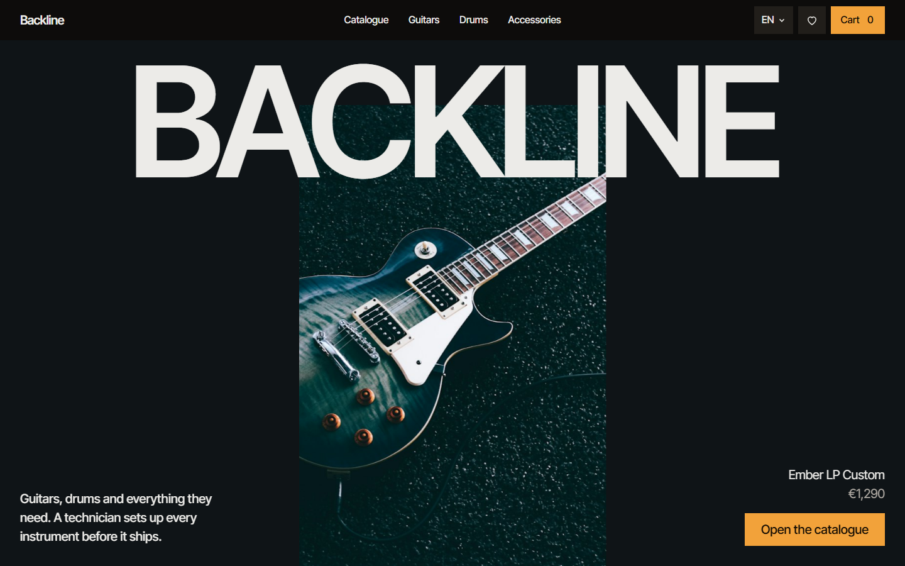
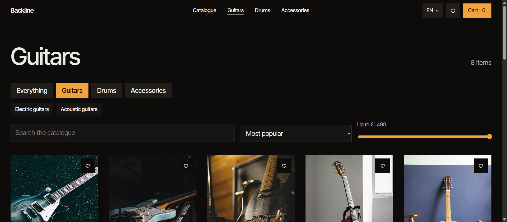
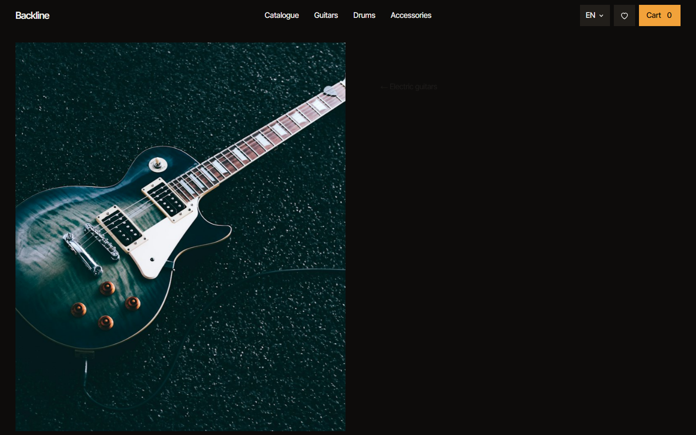
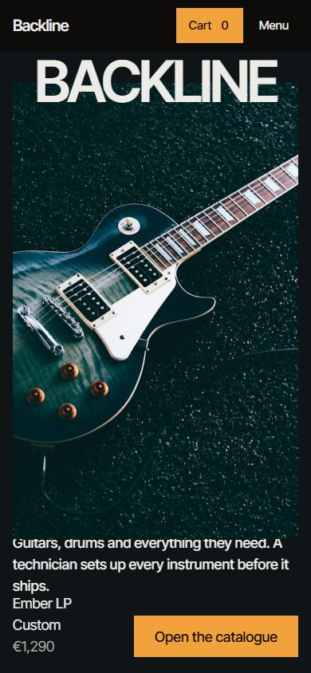

# Backline — a music instrument shop

A single-page shop for guitars, drums, cymbals and the accessories that go with them, built with Vue 3.
Dark "stage at night" design, scroll-driven animation, six languages and a working cart-to-order flow.

**Live demo:** https://max959954.github.io/fronted_final_project/



| Catalogue with filters | Product page | Phone |
| --- | --- | --- |
|  |  |  |

## Features

- **Catalogue** of 24 products across guitars, drums and accessories: department and sub-category filters, search, sorting and a price slider. Every filter lives in the URL, so a filtered view can be shared or bookmarked.
- **Product page** with specifications, quantity, favourites, related items and a **Soundcheck** button that synthesises the instrument in the browser with the Web Audio API (Karplus–Strong strings for guitars, a drum pattern for kits, filtered noise for cymbals). No audio files are downloaded.
- **Cart and checkout**: quantity controls, free-delivery progress bar (free from €300, otherwise €15), form validation with accessible error messages, and an order confirmation page.
- **Persistence**: cart, favourites, past orders and the chosen language survive a reload (localStorage, with a safe fallback when storage is blocked).
- **Six languages**: Russian, English, German, French, Chinese and Japanese, including product descriptions. Prices and dates are formatted per locale with `Intl`.
- **Motion**: pinned hero, staggered section reveals, page transitions, animated cart badge and toasts. Everything respects `prefers-reduced-motion`.
- **Responsive and accessible**: phone layout of its own, keyboard-operable controls, visible focus, `aria-*` on icon buttons, menus and live regions.

## Tech stack

| | |
| --- | --- |
| Framework | Vue 3 (Composition API, `<script setup>`) |
| State | Pinia |
| Routing | Vue Router 4, lazy-loaded pages |
| Build | Vite 7 |
| Styling | Plain CSS with design tokens (custom properties), scoped component styles |
| Deploy | GitHub Actions → GitHub Pages |

## Project structure

```
src/
├── pages/          route components (Home, Catalog, Product, Cart, Checkout, Order, Favorites, Credits, 404)
├── components/     SiteHeader, SiteFooter, ProductCard, QtyStepper, SoundcheckButton, ToastStack
├── stores/         Pinia stores: cart (incl. orders), favorites, app (toasts), persist helper
├── data/           product catalogue and photo credits
├── i18n/           translation runtime and one dictionary per locale
├── composables/    useSoundcheck (Web Audio synthesis)
├── directives/     v-reveal (IntersectionObserver scroll reveal)
└── styles/         global tokens, type scale, controls, motion
```

## Decisions worth explaining

- **The cart stores only `{ id, qty }`.** Prices and names are always read from the catalogue, so a stale price in someone's localStorage can never reach checkout.
- **A small hand-written i18n module instead of vue-i18n.** The app needs key lookup, `{param}` interpolation, arrays for lists and `Intl` formatting, in under 80 lines. A reactive `locale` ref means templates re-render on language change with no plugin. For a larger app with pluralisation rules I would switch to vue-i18n.
- **Filters in the URL, not in a store.** The route query is the single source of truth for the catalogue, which gives back/forward navigation and shareable links for free.
- **No payment form.** There is no backend, so checkout offers pay-on-delivery or bank transfer and stores the order locally instead of pretending to take card details.
- **Deep links on GitHub Pages.** Pages only serves real files, so `/catalog` opened directly would be a 404. A tiny Vite plugin copies `index.html` to `404.html` at build time; Pages serves it for unknown paths and Vue Router renders the right page.

## Getting started

Requires Node.js 20.19+ or 22.12+.

```sh
npm install
npm run dev       # dev server with hot reload
npm run build     # production build into dist/
npm run preview   # serve the production build locally
```

## Deployment

Every push to `main` runs [`.github/workflows/deploy.yml`](.github/workflows/deploy.yml): install with `npm ci`, build, publish `dist/` to GitHub Pages.
One-time setup in the repository: **Settings → Pages → Build and deployment → Source: GitHub Actions**.

## Roadmap

- Unit tests (Vitest) for the cart store and i18n, and one end-to-end checkout test (Playwright)
- ESLint + Prettier, run in CI
- Products served from a mock API, with loading and error states
- Responsive WebP/AVIF images

## Credits

Product names, prices and service terms are sample content. Photographs come from Unsplash and from Wikimedia Commons / Flickr under Creative Commons licences; the full attribution list is on the [photo credits page](https://max959954.github.io/fronted_final_project/credits) and in [`src/data/credits.js`](src/data/credits.js).
